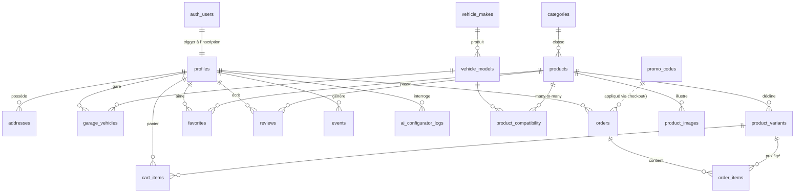

# LIGNE ROUGE

Site e-commerce d'une marque française (fictive) d'échappements haut de gamme pour **voitures et motos** :
lignes complètes, silencieux et embouts en titane, inox et carbone. Deux gammes : **Homologué route** et
**Circuit uniquement**.

- **Site en ligne** : _lien Vercel à compléter après déploiement_
- **Compte admin de démo** : `admin@ligne-rouge.fr` / `LigneRouge#Admin2026`
- **Clients de démo** : `julien@demo.ligne-rouge.fr` (et sofiane, camille, thomas, lea, nicolas, ines, hugo) / `Demo#Client2026`
- **Codes promo** : `ROUGE10` (−10 %), `LAUNCH20` (−20 %)

> Projet étudiant. Marque, produits, avis et commandes de démonstration sont fictifs. Le paiement est simulé.

## Fonctionnalités

| Espace | Ce qu'on peut faire |
|---|---|
| Public | Hero 3D interactif (pot Three.js qui suit le curseur, quincaillerie repoussée par la souris, braises, bascule route ↔ circuit), son d'échappement synthétisé en Web Audio, sélecteur « Trouve le pot de ta caisse », catalogue en fiches visuelles (specs incrustées), boutique filtrable (filtres dans l'URL), fiches produit avec galerie 3 vues, jauges, compatibilité, avis |
| Client | Inscription / connexion Supabase Auth, panier **persisté en base**, code promo, case obligatoire « usage circuit », commande via la fonction SQL `checkout()`, suivi des commandes, **Mon garage**, favoris, adresses |
| Admin | Accès protégé (middleware + vérification serveur du rôle), KPIs (CA, commandes, panier moyen, clients, conversion, paniers en cours), courbe CA 30 j, top produits, route vs circuit, véhicules les plus demandés, stock bas, gestion des statuts de commande, des prix/promos/stocks |
| IA | Configurateur « Son & Perf » : reconnaissance du véhicule en base, filtrage des pots compatibles, recommandation Claude (ou moteur à règles sans clé), règle « jamais de circuit pour un usage route » contrôlée côté serveur, journalisation |

## Stack

Next.js 15 (App Router, TypeScript) · Tailwind CSS 4 · Supabase (Postgres, Auth, RLS, fonctions SQL) ·
`@supabase/ssr` · Three.js + GSAP · recharts · `@anthropic-ai/sdk` · Vercel.

## Base de données

Migrations : `supabase/migrations/001_init.sql` (schéma, RLS, fonctions, vues KPI, seed catalogue),
`002_harden_functions.sql`, `003_split_write_policies.sql` (corrections issues de `get_advisors`),
`004_rebrand_ligne_rouge.sql` (changement de marque), `005_product_photos.sql` (3 photos par produit), `006_product_specs.sql` (diamètre de sortie et points forts).



Points clés :

- **RLS sur toutes les tables** : catalogue en lecture publique / écriture admin ; panier, garage, favoris,
  adresses et commandes visibles par leur seul propriétaire (+ admins). `is_admin()` est `security definer`
  pour éviter la récursion sur `profiles`.
- **Trigger anti-escalade** : un client ne peut pas modifier son propre `role`.
- **`checkout(address_id, promo_code, circuit_ack)`** : une transaction qui verrouille les stocks
  (`for update`), contrôle stock / produit actif / reconnaissance circuit, applique le code promo, calcule la
  livraison (offerte dès 500 €), crée la commande et ses lignes à prix figé, décrémente les variantes, vide le
  panier et logue l'event.
- **`products.stock`** est maintenu par trigger comme somme des stocks variantes.
- **Vues KPI** `kpi_overview`, `kpi_revenue_by_day`, `kpi_top_products`, `kpi_route_vs_circuit`,
  `kpi_top_vehicles`, `kpi_low_stock` : `security_invoker = true` + filtre `is_admin()`.
- **Tracking** : `events` (vues produit, ajouts/retraits panier, checkout, vérifications de compatibilité) et
  `ai_configurator_logs` alimentent la conversion et les « véhicules les plus demandés ».

## Skills utilisées et valeur ajoutée

Les skills Claude Code sont versionnées dans `.claude/skills/` et ont servi pendant tout le développement.

| Skill | Rôle | Valeur ajoutée concrète |
|---|---|---|
| `ligne-rouge-design-system` | Ambiance racing de nuit + rigueur catalogue : tokens (bronze, dégradé titane chauffé, rouge de marque, fond photo), typos, hero 3D à conserver, `ProductCard` fiche visuelle, `Photo` avec repli | Les itérations de direction artistique (clair puis sombre) se sont faites en changeant tokens et composants communs : badges route/circuit et avertissement légal identiques partout |
| `supabase-migrations` | Conventions de nommage, RLS systématique, `(select auth.uid())`, fonctions `security definer` + `search_path = ''`, process « migration → `get_advisors` » | A guidé les migrations 002 et 003 : les alertes de l'advisor (fonctions trigger exposées en RPC, policies `for all` cumulées) ont été corrigées dans des migrations dédiées |
| `add-product` | Procédure d'ajout d'un pot : fiche, illustrations SVG via `scripts/gen-product-svg.mjs`, seed SQL, variantes, compatibilité, vérifications | Les 6 produits et leurs 18 visuels ont été produits avec ce process ; ajouter un 7ᵉ pot est reproductible en quelques minutes |
| `kpi-dashboard` | Chaîne vue SQL `kpi_*` → requête serveur → `KpiCard` / graphique recharts | Les 6 vues KPI et le dashboard suivent le même modèle ; ajouter un indicateur = une vue + une ligne dans `Promise.all` + un composant |

La **skill IA du site** est le configurateur (`/configurateur` et module sur chaque fiche produit), décrit plus haut.

## Installation locale

```bash
npm install
cp .env.example .env.local   # renseigner les clés Supabase
npm run dev
```

Variables d'environnement :

| Variable | Rôle |
|---|---|
| `NEXT_PUBLIC_SUPABASE_URL` | URL du projet Supabase |
| `NEXT_PUBLIC_SUPABASE_ANON_KEY` | Clé publishable / anon |
| `ANTHROPIC_API_KEY` | Optionnelle : active les recommandations Claude du configurateur |

Base de données : exécuter dans l'ordre les fichiers de `supabase/migrations/`, puis `supabase/seed_demo_orders.sql`
(crée le compte admin, les clients de démo et ~40 commandes sur 30 jours).

Dans Supabase → Authentication → Sign In / Providers → Email, désactiver **Confirm email** pour que
l'inscription connecte immédiatement le client.

Photos produit : déposer les fichiers dans `public/photos/` (liste et prompts dans `docs/prompts-photos.md`). Tant qu'une photo manque, le site affiche un visuel provisoire généré par `node scripts/gen-product-svg.mjs`.

Identité (plaque rivetée LIGNE ROUGE) : `node scripts/gen-brand.mjs` régénère `public/brand/`.

## Équipe

Voir [TEAM.md](TEAM.md).
